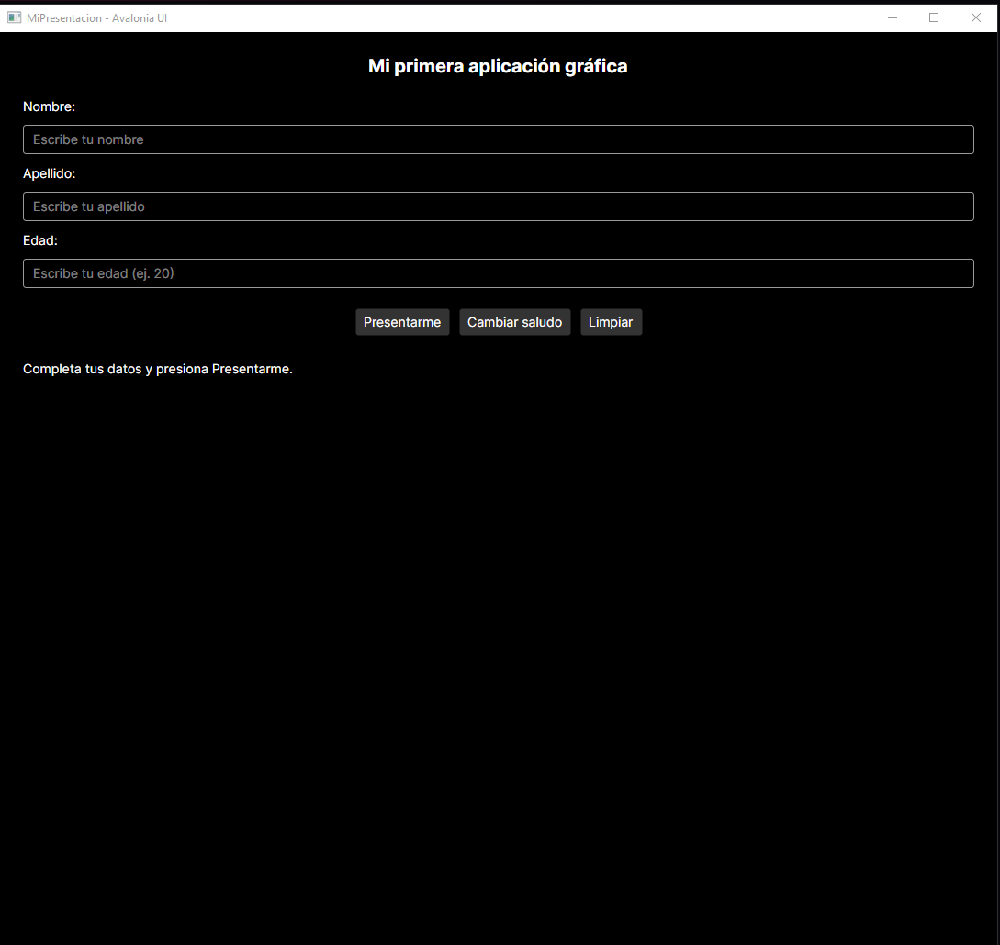
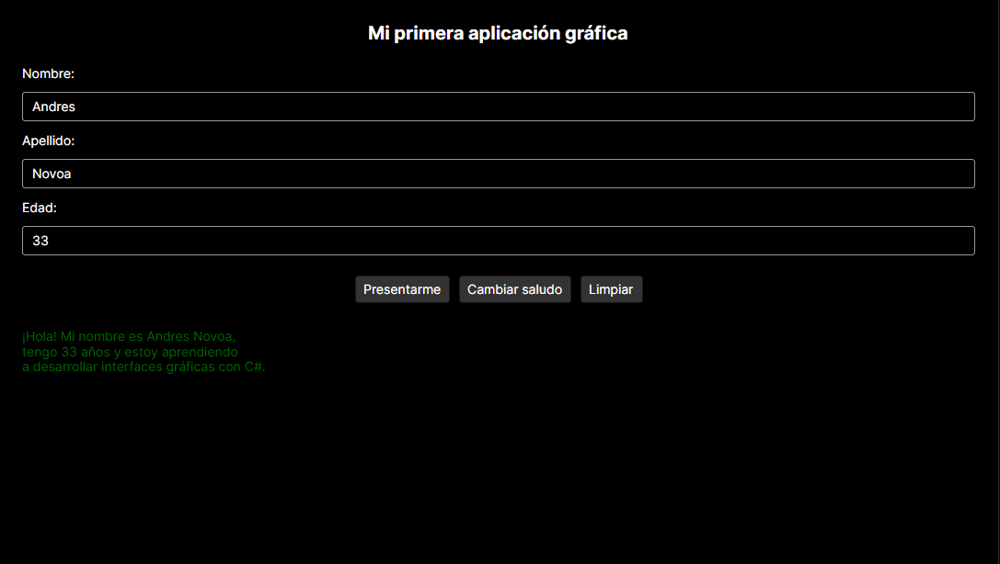
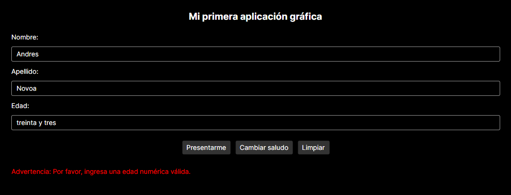

# MiPresentacion — Aplicación de Escritorio con Avalonia UI 11

Aplicación gráfica desarrollada en C# y Avalonia UI 11 que permite capturar el nombre, apellido y edad de una persona, validar los datos ingresados y mostrar un mensaje de presentación personalizado con opción de alternar entre dos estilos de saludo.

## Controles utilizados (XAML)
- **`Window`**: Ventana principal de la aplicación con dimensiones fijas y centrada en pantalla.
- **`StackPanel`**: Contenedor utilizado para organizar verticalmente los elementos del formulario y horizontalmente los botones, aplicando `Margin` y `Spacing`.
- **`TextBlock`**: Utilizado para mostrar el título principal, las etiquetas de cada campo y el área donde se imprime el resultado o las advertencias.
- **`TextBox`**: Campos de entrada de texto (`TxtNombre`, `TxtApellido`, `TxtEdad`) con texto guía (`Watermark`).
- **`Button`**: Botones interactivos (`BtnPresentarme`, `BtnCambiarSaludo`, `BtnLimpiar`) enlazados a eventos `Click` en C#.

## Funcionamiento de los eventos (C#)
- **`BtnPresentarme_Click`**: Lee el texto de los tres `TextBox`, verifica mediante `string.IsNullOrWhiteSpace()` que el nombre y el apellido no estén vacíos y valida con `int.TryParse()` que la edad sea un número entero mayor a cero. Si todo es correcto, muestra el saludo; de lo contrario, muestra una advertencia en rojo.
- **`BtnCambiarSaludo_Click`**: Alterna una variable booleana (`usarSegundoSaludo`) para cambiar entre dos formatos de presentación sin tener que cerrar la aplicación.
- **`BtnLimpiar_Click`**: Borra el contenido de las tres cajas de texto, restablece el mensaje inicial y devuelve el foco al campo del nombre utilizando `TxtNombre.Focus()`.

## Instrucciones para ejecutar el programa
1. Clonar el repositorio:
   ```bash
   git clone [https://github.com/novoag22/MiPresentacion-Avalonia.git](https://github.com/novoag22/MiPresentacion-Avalonia.git)
   ```
2. Entrar a la carpeta del proyecto:
   ```bash
   cd MiPresentacion
   ```
3. Ejecutar la aplicación con .NET:
   ```bash
   dotnet run
   ```

## Evidencias de funcionamiento

### 1. Formulario inicial


### 2. Presentación válida


### 3. Validación de datos


---

## Pregunta de reflexión

**¿Cuál es la función de `MainWindow.axaml` y `MainWindow.axaml.cs`, y cómo se relacionan mediante `x:Name` y los eventos `Click` para permitir que el usuario interactúe con la aplicación?**

En mi programa, `MainWindow.axaml` se encarga exclusivamente de la parte visual, es decir, de definir qué controles ve el usuario en la ventana (el título, las cajas para escribir y los botones) y cómo están acomodados en pantalla. Por otro lado, `MainWindow.axaml.cs` contiene toda la lógica en C# que decide qué hacer con la información cuando ocurre una acción.

Ambos archivos se conectan de dos maneras principales: primero, mediante la propiedad `x:Name` en el XAML, que le da un identificador único a cada control (como `TxtNombre` o `TxtResultado`) para que desde el código en C# yo pueda leer lo que el usuario escribió o cambiar el texto de respuesta; y segundo, mediante los eventos `Click` de los botones, que enlazan el clic del usuario en la interfaz con un método específico en C# (`BtnPresentarme_Click`, `BtnLimpiar_Click`, etc.) para validar los datos y actualizar la pantalla al instante.